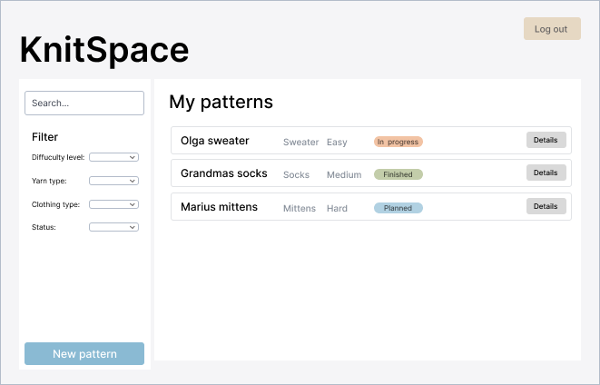
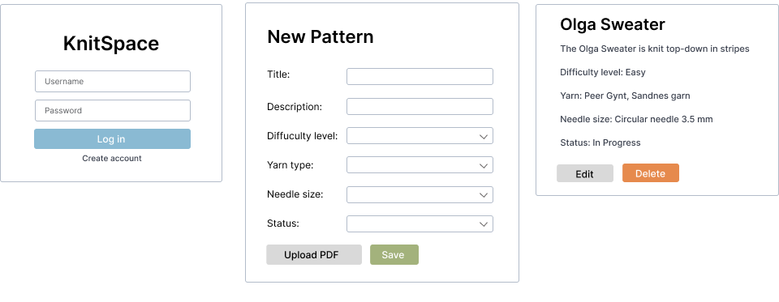

# KnitSpace - Application

This application is designed as a personal storage space for all your knitting recipies. The idea is that each user can register, log in and then save and keep their own private collection of recipies. 

Each recipe can include information such as a title, description, difficulty level, type of clothing, needle size and yarn type. There will also be possible to upload a PDF file if needed. 

The app will make it possible to add new recipies, edit or delete existing ones, and to search or filter the recipies based on the following criteria:
-	Difficulty level
-	Status (Planned / In progress / Finished)
-	Clothing type
-	Yarn type

The main view will be the overview page where users can see all their recipies and projects in one place. 

The main code for the app is located in the `/ui` folder. 

## User stories

- As a knitting prodigy, I wish to have an overview of all my knitting recipies, so that I can quickly find and choose which project to work on. 
- As a traveller, I wish to have all my recipes in one place digitally, so that I can bring the recipes with me at all time.
- As a beginner knitter, I want to filter recipes by difficulty level, so that I can find recipies that match my skill level. 

## Screenshots

### Main view

### Additional views
